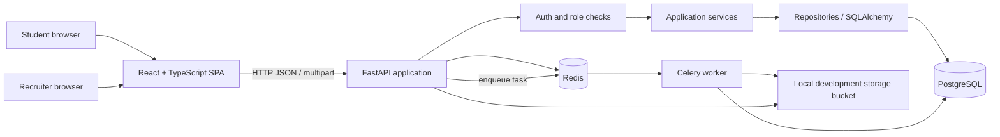

# SmartHireAI architecture

This document describes the current source layout and intended request flow. Runtime OpenAPI output and `backend/app/main.py` should be checked whenever route registration changes.

## High-level architecture

## Frontend

The `frontend/` project uses React and TypeScript. `server.ts` runs Express with Vite middleware for development and serves the built SPA in production mode. React Router defines student, recruiter, admin, authentication, dashboard, and settings routes. Redux Toolkit stores shared UI/auth state; TanStack Query is configured for server-state use; Axios is the common API client.

The API client reads `VITE_API_URL` and otherwise defaults to `http://127.0.0.1:8000/api/v1`. It attaches the stored access token as a Bearer token when one is present.

The UI includes both backend-connected flows and screens with prototype or illustrative values. Review service calls and the runtime API schema before treating displayed metrics as authoritative.

## Backend layers

- **API layer** — FastAPI router modules, request dependencies, DTO validation, and HTTP responses.
- **Application layer** — services for authentication, resumes, jobs, applications, sourcing, interviews, offers, settings, and reporting.
- **Infrastructure layer** — SQLAlchemy database sessions and repositories, Redis cache, storage adapter, AI/ATS helpers, and Celery tasks.
- **Core layer** — settings, security helpers, logging, and exception handling.
- **Migrations** — Alembic migration scripts under `backend/alembic/`.

The data-access code uses async SQLAlchemy sessions and PostgreSQL. The default API lifespan attempts Alembic migrations on startup and attempts a Redis connection. Redis connection failure is logged and the cache wrapper can run without a cache connection, but Celery-backed resume parsing requires the broker and worker.

## Authentication and request flow

1. A student or recruiter registers/logs in through a role-specific auth endpoint.
2. The backend validates the request and issues access/refresh tokens.
3. The frontend keeps the access token in browser storage and the API client adds it to protected requests.
4. Backend dependencies identify the current user and restrict recruiter-only operations to the authenticated recruiter's company context.
5. Services run application logic and persist records using repositories/database sessions.

For production use, review token storage, token rotation/revocation, refresh/logout behavior, account recovery, rate limits, and audit logging with security testing.

## Resume processing flow

1. The frontend submits a resume as multipart form data to `POST /api/v1/resumes`.
2. The API records the resume and queues a Celery task.
3. The worker retrieves file bytes from the storage adapter, extracts PDF text with pypdf, derives structured fields, and updates the resume record.
4. The frontend polls resume status and displays parsed details when processing completes.
5. The frontend can submit extracted skills to the ATS scoring endpoint and display matched/missing skills and a score breakdown.

The included storage adapter writes to a local `storage_bucket/` directory. Despite its S3-style interface and configuration fields, it does not currently upload to AWS S3. Do not use it as durable production storage without implementing and testing a real storage adapter.

## Data and supporting services

- **PostgreSQL** stores users and application-domain records.
- **Redis** supports cache access and is configured as the Celery broker/result backend.
- **Celery worker** runs background tasks such as resume parsing.
- **RabbitMQ** is included in Docker Compose, but current Celery settings point to Redis instead.
- **AI/ATS helpers** include skill comparison and parsing/matching modules. The live API routes are those registered in `backend/app/main.py`; modules elsewhere in the source tree may not be active.

## Trust boundaries

- Browser input is untrusted; validate it server-side.
- Resume files and extracted text can contain personal information. Minimise retention and avoid logging file contents.
- A score or ranking is not a hiring decision and requires human review.
- Secrets belong in environment variables or secret managers, never source control.
- Production deployment should use TLS, restrictive CORS, database least privilege, private storage, backups, access logging, and a documented data-retention policy.
